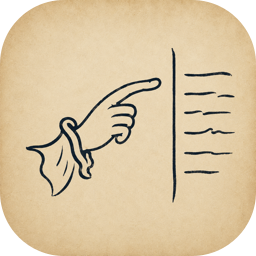

<p align="center">
  
</p>

<h1 align="center">Scholium</h1>

<p align="center">
  <strong>面向哲学与人文研究的原生 macOS 研究环境。</strong><br>
  研读来源，发展议题，写出自己的论证。<br>
  以本地 Markdown 保存研究，也可邀请 Agent 参与协作。
</p>

<p align="center">
  <a href="https://github.com/Aaronlves/Scholium/releases/download/v0.4.5-beta.1/Scholium-v0.4.5-beta.1-macos-arm64.dmg"></a>
</p>

<p align="center">
  <a href="https://github.com/Aaronlves/Scholium/actions/workflows/verify.yml"></a>
  <a href="https://github.com/Aaronlves/Scholium/releases"></a>
  <a href="Package.swift"></a>
  <a href="Package.swift"></a>
  <a href="LICENSE"></a>
</p>

<p align="center">
  <a href="https://github.com/Aaronlves/Scholium/releases">版本发布</a> ·
  <a href="#开始使用">开始使用</a> ·
  <a href="Docs/SCHOLIUM_SPEC.md">项目文档</a> ·
  <a href="README.md">English</a>
</p>

---

## 从研究文档出发

Scholium 将来源分析、概念研究与持续写作放在同一个研究环境中。文档始终是你所选
文件夹里的普通 Markdown。人工研究核心无需 Obsidian、Zotero 或 Agent 即可使用。

每个研究领域以一个<strong>脉络（Triptych）</strong>组织：

| 工作区 | 保存什么 |
| --- | --- |
| **分析 · Analyses** | 对论文及其他来源的细读与可复用分析。 |
| **议题 · Topics** | 跨来源的概念、区分、争论、反驳与综合。 |
| **写作 · Works** | 你自己的计划、论证、草稿、评估与完成稿。 |

在<strong>审阅（Review）</strong>、<strong>编辑（Edit）</strong>与<strong>源码（Source）</strong>之间切换，搜索研究材料，
沿作者写下的链接及注释继续阅读，也可在写作时查阅 Writing References。
检索帮助你找到材料；材料是否支持一个主张，仍需判断。

准确的 Markdown 是内容权威。自动保存、Changes 比较、冲突处理与恢复支持你和其他
编辑器共同处理文件。来源、解释、Agent 贡献与你的判断保持各自角色；由你决定哪些
内容进入自己的研究。

## 开始使用

**需要 macOS 26 或更高版本，以及 Apple 芯片 Mac。** 运行打包应用无需安装 Xcode。

1. 从 [v0.4.5-beta.1](https://github.com/Aaronlves/Scholium/releases/tag/v0.4.5-beta.1)
   下载 DMG 及对应 SHA-256 文件。运行
   `shasum -a 256 Scholium-v0.4.5-beta.1-macos-arm64.dmg`，与校验文件中的结果比较。
2. 打开 DMG，将 **Scholium** 拖到**应用程序**，然后推出 DMG。
3. 尝试启动 Scholium。当前 Beta 采用 ad-hoc 签名，尚无 Developer ID 签名或公证。
   若被 macOS 阻止，打开**系统设置 → 隐私与安全性 → 仍要打开**，完成认证并确认
   **打开**。保持 Gatekeeper 启用。
4. 分别选择脉络的**分析**、**议题**与**写作**文件夹。可以放在同一父目录下，也可
   分别存放。为了访问“写作”旁边的便携式 `.scholium/` 控制数据，macOS 还会请求
   访问“写作”所在的文件夹。

使用**文件 → 新建脉络…**配置另一个研究领域，使用**文件 → 打开脉络**打开已注册
脉络，或通过**文件 → 新建窗口**为当前脉络再开一个窗口。两个脉络不能共享同一个
“写作”侧控制目录。

当前公开发行属于 **Core App Beta**。外部 Agent 协作与可选的应用内 Chat 仍处于
**Preview**。打包发行证据及尚未完成的人类 UI、辅助功能与性能验收，见
[实现状态](Docs/IMPLEMENTATION_STATUS.md)与
[发行说明](https://github.com/Aaronlves/Scholium/releases/tag/v0.4.5-beta.1)。

## 可选集成

### Agents 与 Chat · Preview

可以在应用内 Chat 中使用兼容的官方 Codex 可执行文件，也可以通过 Scholium MCP
连接外部 Agent host。应用内随附的连接组件需要 Scholium 正在运行，并打开预期脉络。

<strong>应用内 Chat：</strong>将左侧边栏切换到 **Chat**，选择 Codex 可执行文件和随附连接组件，
再通过 Codex 连接并登录。发送请求前选择 **Ask for Approval** 或 **Full Access**。
在 Edit 或 Source 中，通过 **View → Add Selection to Chat**（`⇧⌘L`）添加选中文字；
添加材料不会直接发送。Operation History 保留实际 MCP 变更和符合条件的 Undo。
中断或结果不确定的请求不会自动重发。

每个脉络的 `.scholium/` 是其 Chat 工作目录。将本地指令写入 `AGENTS.md`，将 Skills
放入 `skills/<name>/SKILL.md`。设置提供 **Open Chat Workspace in Finder** 和
**Refresh**。Codex 登录与运行时设置使用共享的本机配置；选择已有配置会继承其中的
工具和设置。

<strong>外部 host：</strong>打开 **Settings → Agents → External Access**，复制并运行相应
host 的设置命令。命令使用已安装应用中连接组件的准确路径。
移动应用后需重新复制并运行；原位置更新可保留路径。Scholium 只复制命令，不修改
host 配置。外部对话始终留在其 host 中。

Scholium MCP 提供检索、来源附件、受保护的笔记操作与 Agent Change 比较和恢复。
应用或目标脉络不可用时，连接组件会明确失败。当前支持范围见
[工具契约](Docs/Specification/03-agent-collaboration-and-workflows.md#83-tool-contract)。

### Zotero

在 **Zotero 设置 → 高级**中启用**允许本机其他应用与 Zotero 通信**。Chat 使用随附的
`scholium-zotero` 连接搜索和读取文献库材料、导出引用，并在明确确认且获得 Zotero
本地 API 授权后修改条目。BibTeX 与 RIS 仍在 Zotero 中导入，无需另装社区服务或
Python 运行时。

读取原始 PDF 时，打开 **Scholium Settings → Zotero → Original File Access →
Choose Zotero Library Folder…**，确认 **Allow Read Access**。也可授权访问链接文件
所在的文件夹或单个原始文件。访问权限只读、保存在 This Mac 中，并可在设置中撤销。

Zotero 始终是文献库权威；Scholium 不直接访问其私有数据库。支持的操作与引用行为见
[Zotero 集成](Docs/Specification/05-integrations-onboarding-and-boundaries.md#15-zotero-integration)。

## 项目文档

| 文档 | 内容 |
| --- | --- |
| [规格](Docs/SCHOLIUM_SPEC.md) | 产品工作流、界面、辅助功能与发行要求。 |
| [Design](Design.md) | 全局设计理念与视觉身份。 |
| [架构](Docs/IMPLEMENTATION_ARCHITECTURE.md) | 模块、状态归属、事务与编辑器边界。 |
| [实现状态](Docs/IMPLEMENTATION_STATUS.md) | 当前可达能力、未完成工作与注明日期的验证证据。 |
| [开发规则](AGENTS.md) | 修改范围、验证与一次性测试数据要求。 |

## 开发

需要完整 Xcode，以及 [Package.swift](Package.swift) 要求的编译器与 SDK。
重建 TypeScript 编辑器 bundle 时需要 Node.js。从仓库根目录运行：

```bash
developer_dir="$(./Tools/Scripts/resolve-xcode-developer-dir.sh)"
export DEVELOPER_DIR="$developer_dir"
swift build
./Tools/Scripts/run-debug-app.sh
```

解析器支持有效的 `DEVELOPER_DIR`、完整的 `xcode-select` 选择，以及常规位置中的
Beta 或正式版 Xcode。仓库须位于 Desktop、Documents、CloudStorage 等 File Provider
管理目录之外。构建缓存、QA 状态、测试数据副本与日志均保存在仓库内被忽略的
`.build/` 下。测试只使用一次性、非私密数据。

<details>
<summary><strong>验证与开发工具</strong></summary>

依据 [AGENTS.md](AGENTS.md) 为修改选择适当检查。

| 任务 | 命令 |
| --- | --- |
| Swift 测试 | `swift test` |
| Swift 格式检查与编辑器类型检查 | `./Tools/Scripts/lint.sh` |
| 应用 Swift 格式后检查 | `./Tools/Scripts/lint.sh --fix` |
| 日常仓库门禁 | `./Tools/Scripts/verify.sh --ci` |
| 完整仓库门禁 | `./Tools/Scripts/verify.sh` |
| 规范 UI 旅程 | `./Tools/Scripts/run-ui-tests.sh smoke` |
| 保留的关键 UI 套件 | `./Tools/Scripts/run-ui-tests.sh complete` |
| 重建编辑器 bundle | `./Tools/Scripts/build-editor.sh` |
| 验证已检入的编辑器 bundle | `./Tools/Scripts/verify-editor-bundle.sh` |
| 验证文档权威与链接 | `python3 Tools/Scripts/validate-documentation-authority.py` |

推送与 PR 的 CI 报告 **Repository verification**。经过验证、属于已有 Markdown
白名单的修改使用 `verify.sh --docs`；其他修改使用日常门禁。日常门禁省略两个昂贵的
WebView 套件与 Release 构建及其 helper 检查，这些检查保留在完整门禁中。
日志、计时、摘要与跳过项保存在 `.build/ci-verification/runs/` 下。

发布 Beta 前，在本机运行完整门禁，并在手动 **Verify** workflow 中为准确候选 ref
选择 **full**，同时完成适用的打包启动、产物与性能门禁。CI 通过
`SCHOLIUM_SKIP_MEASUREMENT_EVIDENCE` 与 `SCHOLIUM_SKIP_DISPLAY_EVIDENCE`
跳过校准计时和依赖显示环境的证据；这些检查需要开发用 Mac。自动化检查不能代表
人类视觉或辅助技术验收。发行要求归[规格](Docs/Specification/10-release-and-open-decisions.md)所有。

UI runner 将标准 500 笔记 [TestVaults](TestVaults/README.md) 复制到隔离的 `.build/`
状态中。三个研究库须分别注册；不要修改源测试数据，也不要使用真实研究库测试。

按需运行规模诊断：

```bash
python3 Tools/Scripts/generate-stress-vaults.py .build/stress-fixture
SCHOLIUM_STRESS_FIXTURE="$PWD/.build/stress-fixture" \
  swift test --filter LargeVaultStressDiagnosticTests
SCHOLIUM_TEST_VAULTS="$PWD/.build/stress-fixture" ./Tools/Scripts/run-ui-tests.sh stress
```

生成器默认创建 5,000 个合成笔记（`--notes` 接受 500–20,000）；完整诊断至少需要
508 个。两项诊断都会复制测试数据。场景测量不能代表打包性能门禁。

在 Finder 中使用 `Manage Scholium Development Storage.command`，或运行
`./Tools/Scripts/manage-development-storage.sh report` 检查存储。`clean-stale`、
`clean-all`、`clean-editor` 默认为 dry run；审查允许清理的目标后才添加 `--delete`。
编辑器依赖只由 `clean-editor` 移除。

</details>

## 文件与本机状态

研究正文与评估始终是所选文件夹中的普通 Markdown。便携式控制数据保存在“写作”
旁边、范围受限的 `.scholium/` 结构中。Bookmark、绝对路径、会话、索引、保存的查询、
恢复、本机 bridge 认证与准确 Agent Change 证据保存在这台 Mac 上：

```text
~/Library/Application Support/Scholium/State-v1/
```

详见[存储边界](Docs/Specification/01-foundation-and-triptych.md#33-scholium-and-machine-local-state)与
[保存和恢复](Docs/Specification/04-connect-search-and-recovery.md#14-save-agent-changes-and-recovery)。
应用、随附连接组件与 Core Protocol 一同更新。通过 **Scholium → 检查更新…**
下载、验证并安装新版本；自动检查需要主动同意，安装重启沿用保存与退出检查。
旧 Beta 用户需要先手动安装一次带更新器的版本；不单独发行 CLI。
发布者配置见[更新发布流程](README.md#publishing-application-updates)。

## 许可证

除非另有说明，Scholium 原创源码采用
[GNU General Public License, version 3 or later](LICENSE)（`GPL-3.0-or-later`）。
第三方组件保留各自许可证；详见[第三方声明](THIRD_PARTY_NOTICES.md)。
